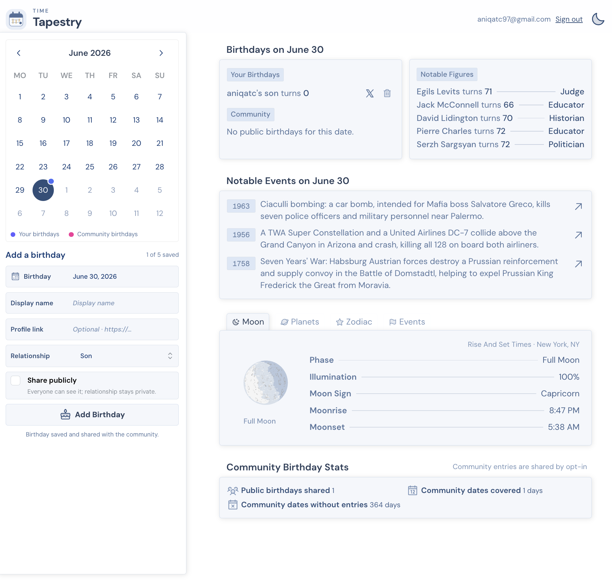

# Time Tapestry

A calendar for birthdays, notable dates and the sky. Pick a day to explore birthdays, events and astronomy, then save birthdays of your own.

[Live site](https://tt.aniqa.dev/) · [GitHub repository](https://github.com/aniqatc/time-tapestry)

## Features

- **Browse a date:** use the calendar to explore historical events and notable birthdays.
- **Save birthdays:** add up to five birthdays to your account. They are private by default; opt in to share selected birthdays with the community.
- **Explore the sky:** see the Moon phase and illumination, planetary positions, tropical and Chinese zodiac details, and upcoming lunar and solar eclipses.
- **Switch themes:** use the app in light or dark mode.
- **Install as an app:** the responsive calendar includes a PWA manifest and app icons.

## Tech

- React, TypeScript and Vite
- Tailwind CSS, Mantine and Motion
- Supabase Auth and Postgres for shared birthdays
- Resend for magic link emails
- Astronomy Engine for local astronomical calculations
- Wikimedia On This Day feed for historical events and birthdays
- Vite PWA for install support

## Privacy

Birthdays are private unless their owner chooses to share them.

## Project structure

- `src/components/Content/`: birthdays, historical events and astrology panels
- `src/components/Sidebar/`: date picker and birthday form
- `src/contexts/`: date, theme, authentication and birthday state
- `src/services/`: Supabase client
- `src/utils/astrology.ts`: Moon, planet, zodiac and eclipse calculations
- `supabase/migrations/`: database schema and access policies
- `public/`: homepage screenshot, app icons and social link preview image

## Commands

- `npm start` — run the development server at `http://localhost:3000`
- `npm run build` — type-check and create a production build
- `npm run preview` — serve the production build locally
- `npm run lint` — run ESLint
- `npx playwright test` — run the homepage check

## Changelog

### October 2026

- Added private-by-default birthday saving with optional community sharing.
- Added light and dark themes and date-based Moon, planet, zodiac and eclipse information.
- Refined responsive sidebar behavior, sharing metadata and app icons.
